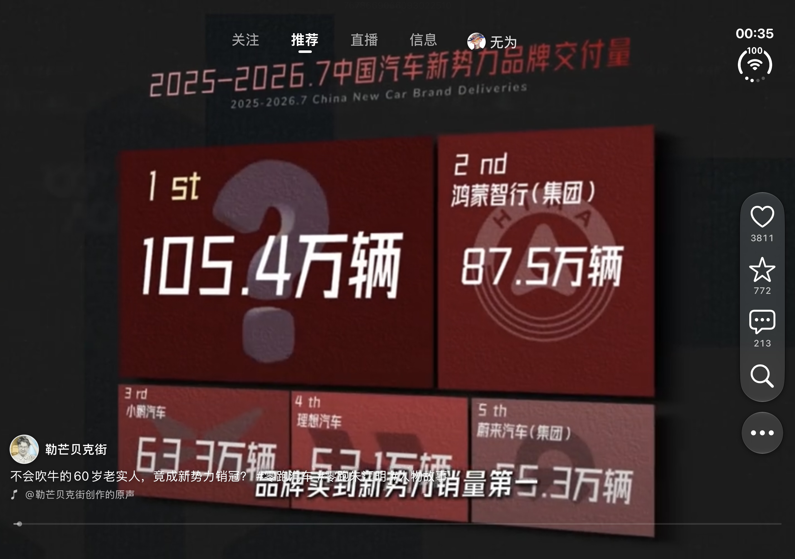
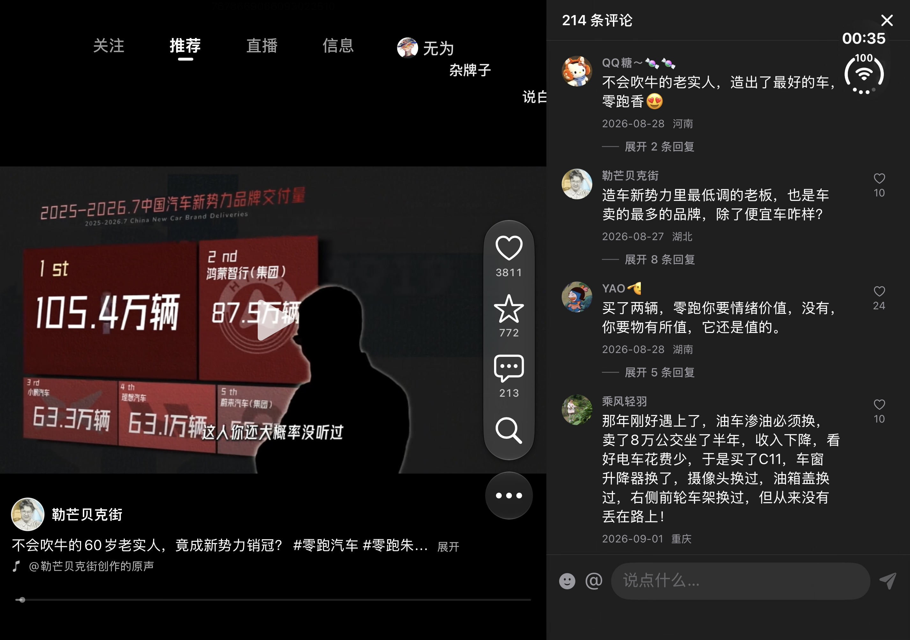
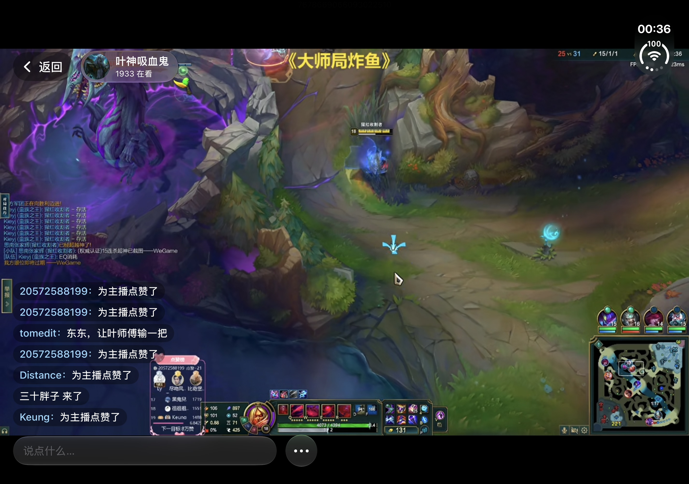
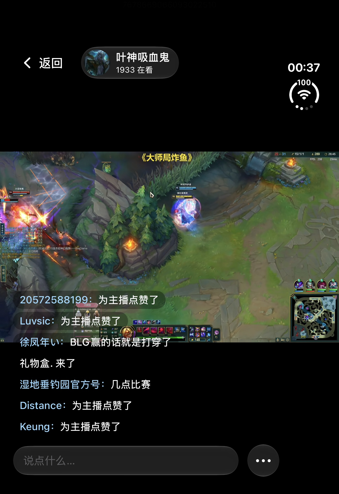
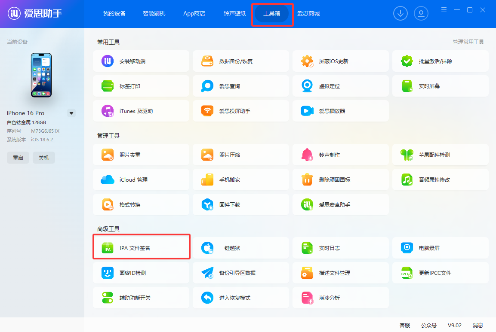
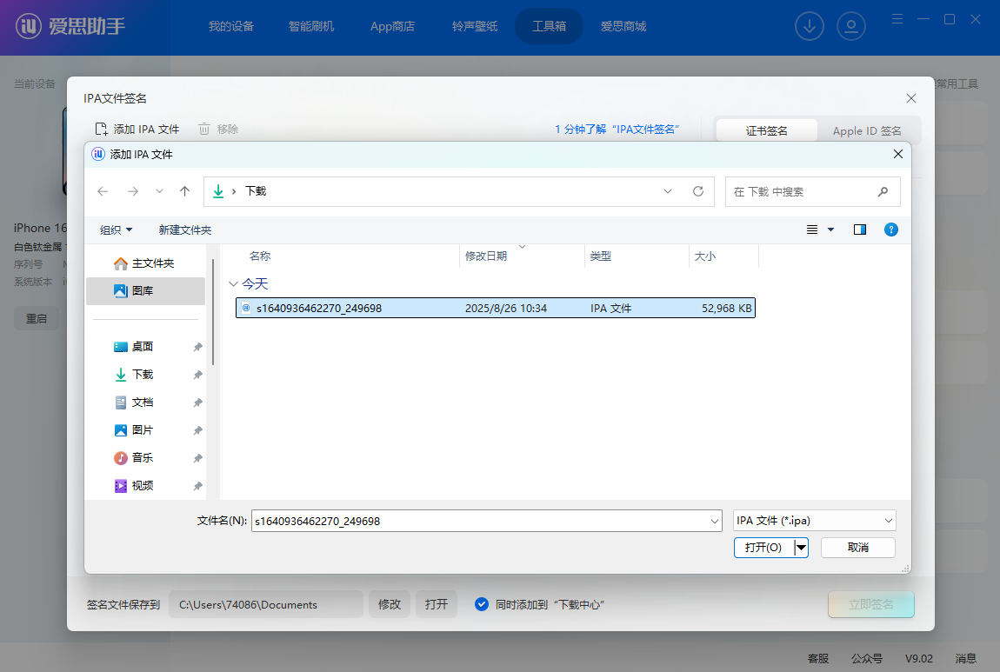
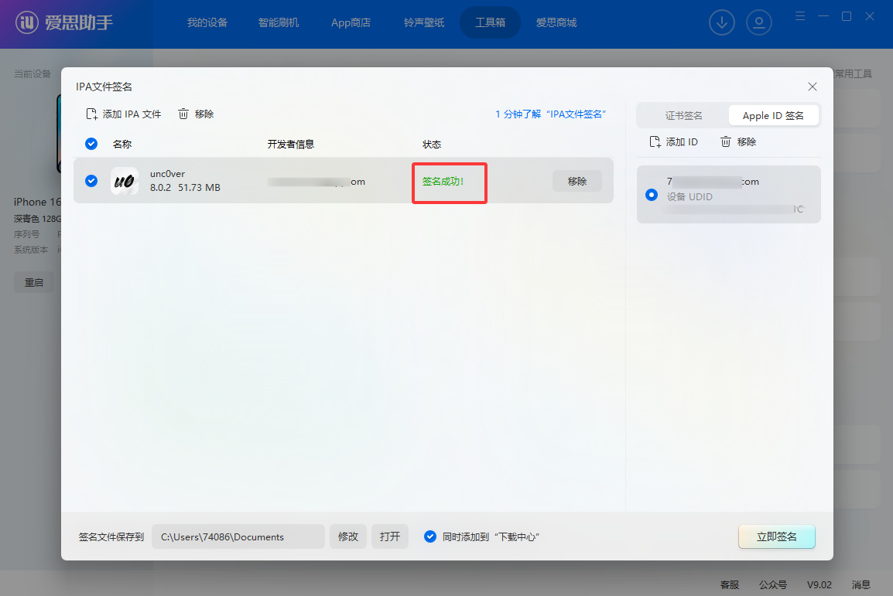

# DouDuo · Duo 定制版

基于上游 **v1.3.11（d3fa371）**，定制构建 **88**，仅面向 **iPhone Duo / iOS 27.1+**。

互动操作位于系统状态栏下方，保留数量；收起的 Dock 提供主页、私信、我的；顶部更多和搜索无玻璃背景；标题与进度条避开系统侧栏；评论使用 Liquid Glass。播放和网页数据桥继续使用上游实现。

详细改动、构建与验收说明见 [Duo 定制说明](docs/releases/v1.3.11-duo.md)。本仓库 Actions 的 **Build unsigned IPA** 产物为定制包；下文上游发行版链接及旧截图供原项目参考。

一个**适配 iPhone Duo（折叠屏）/ iPad / 横屏的第三方抖音客户端**，界面和播放全部原生（SwiftUI + AVPlayer，VLC 兜底）。

官方抖音 App 在折叠屏内屏、iPad 上不适配，网页版又总是跳 App，所以有了它。

## 界面展示

以下为实际使用截图，保留原始画面，未打码；支持外屏、内屏与横竖屏布局。

### 竖屏播放：外屏 / 内屏

<p align="center">
  
  
</p>

### 内屏横屏播放与侧边评论





### 外屏横屏播放


### 直播：内屏横屏 / 外屏竖屏



<p align="center">
  
</p>

[查看截图说明与原图](docs/screenshots/README.md)。

> ⚠️ 非官方项目，仅供个人学习交流，与抖音 / 北京微播视界科技有限公司无关。详见文末[声明](#声明)。

## 功能

**看视频**
- 推荐 / 关注 / 直播，顶部一排切换；整页上下滑
- **秒开**：打开 App 先播上次已缓存的视频，连接抖音在后台进行
- **预缓存**：边看边在后台把后面 50 条完整下载到本地，下滑不等加载（菜单可选 关 / 20 / 50 / 100 条，总量超 2GB 自动清理）
- 屏幕任意位置**横滑快进 / 快退**（带预览缩略图），双击点赞，长按 2 倍速，单击暂停
- **自动铺满**：竖屏看竖屏铺满宽度、横屏看横屏铺满高度；方向不一致时保持完整画面（菜单可关）
- 退到后台立即停声

**互动**（需在 App 内登录抖音，见下文）
- 点赞、收藏，同步到你的抖音账号
- 评论：查看、展开楼中楼、**发评论 / 回复**
- **视频弹幕**：显示 + 发送（菜单可关）
- 直播：原生播放（VLC 解 HEVC 流）、**直播间聊天显示 + 发言**
- 保存视频 / 图集到相册

**我的**
- 搜索（联想词、搜索历史）
- 喜欢 / 收藏 / 观看历史 / 稍后再看，点进去接着上下滑
- 作者资料卡

## 下载与签名安装（国内用户）

- **Gitee 国内下载**：[发行版与 IPA 附件](https://gitee.com/remon8/douduo/releases)
- **GitHub 下载**：[最新发行版](https://github.com/81199000/DouDuo/releases/latest)
- GitHub 为主仓库，Gitee 为国内源码与安装包镜像。
- 下载文件名带 `unsigned.ipa` 的安装包；它是**未签名 IPA，不能下载后直接安装**，需要按下方教程自己签名。
- v1.3.11 消息中心主从导航、聊天分享视频跳原生播放、评论通知回复与配图、聊天黑色画布与窄屏遮挡修复；右侧图标间距加大并调整展开位置；合入直播恢复与播放门禁（分享浮层暂停、切台恢复），详见[更新说明与待验收项](docs/releases/v1.3.11.md)。
- v1.3.10 倍速控制重做：设置里选播放速度（当前视频立刻生效）、长按下滑锁本条 2 倍速、长按上滑取消、非常速常驻角标；新增后台播放与锁屏控制、直播间选择列表、直播画质选档，详见[更新说明](docs/releases/v1.3.10.md)。
- v1.3.9 把「关注的人正在直播」头像排移到直播页顶部：进入展开、上滑换直播间收成「N 个直播」胶囊，关注页回归纯关注流，详见[更新说明](docs/releases/v1.3.9.md)。
- v1.3.8 新增原生「分享给」浮层（真实好友、官方作品卡片、发送即时回执），朋友与会话改为本地缓存 + 增量同步，弹幕限制在画面上方三分之一，直播分类接入真实分区，右侧栏顺序与间距对齐原版，详见[更新说明](docs/releases/v1.3.8.md)。
- v1.3.7 新增消息中心、陌生人消息分类、评论表情与 @ 用户、评论配图/贴纸及直播发现入口，详见[更新说明](docs/releases/v1.3.7.md)。

## 安装

本定制构建支持 iPhone Duo / iOS **27.1 及以上**。DouDuo 未在 App Store 上架，需要**自己签名安装**。以下方式任选一种：

先到 [Gitee 发行版](https://gitee.com/remon8/douduo/releases) 或 [GitHub Releases](https://github.com/81199000/DouDuo/releases/latest) 下载最新的 `DouDuo-x.y.z-unsigned.ipa`，不要下载源码 ZIP 代替 IPA。

### 方式一：爱思助手（Windows / Mac，最简单）

以下配图来自[爱思助手官方 IPA 签名教程](https://www.i4.cn/news_detail_38195.html)；**图中的应用文件名仅为官方示例，实际请选择我们下载的 `DouDuo-1.3.11-unsigned.ipa`**。

#### 1. 连接手机，打开 IPA 签名工具

电脑安装 [爱思助手](https://www.i4.cn)，用数据线连接 iPhone / iPad；解锁设备并点「信任此电脑」，确认电脑能识别设备，再进入 **工具箱 → IPA 签名**。



#### 2. 添加 DouDuo 安装包

点击「添加 IPA 文件」，选择发行版附件中的 `DouDuo-x.y.z-unsigned.ipa`，不要选择源码 ZIP。



#### 3. 使用 Apple ID 签名，选择要安装的设备

选择 **使用 Apple ID 签名 → 添加 Apple ID**，在爱思助手内输入 Apple ID 和密码（建议使用专门的小号），并选择当前连接手机的设备标识。签名与所选设备绑定，不要选成其他手机；如要求验证码，请在签名工具中完成验证。


#### 4. 勾选安装包和 Apple ID，开始签名

勾选 DouDuo IPA 与对应 Apple ID，点击「开始签名」，等待状态显示「签名成功」。



#### 5. 打开签名目录，手动安装已签名 IPA

**签名完成不等于已经安装。** 点击「签名文件保存到」旁边的「打开」，找到新生成的已签名 IPA；它与刚下载的未签名原包可能不在同一个目录。


在打开的目录中找到已签名 IPA，双击交给爱思助手安装，或从爱思助手的应用管理中导入安装；**不要拿未签名原包直接安装**。


#### 6. 在手机上信任开发者并打开应用

手机打开 **设置 → 通用 → VPN 与设备管理**，找到签名使用的 Apple ID / 开发者条目，点「信任」。如系统要求，再打开 **设置 → 隐私与安全性 → 开发者模式**，按提示重启并确认启用，随后打开 DouDuo。

> **7 天到期怎么办？** 免费 Apple ID 签名通常 **7 天后过期**，届时可能打不开；重复以上签名流程并覆盖安装。尽量使用同一 Apple ID、保持相同应用标识，**不要先卸载旧 App**，以免丢失本地数据。
>
> **常见问题**：安装失败先检查设备是否选对、手机是否解锁并信任电脑，以及是否使用签名后的 IPA；不受信任或开发者模式提示按第 6 步处理。不同版本爱思助手的按钮名称和位置可能略有不同。

### 方式二：Sideloadly（Windows / Mac）

1. 安装 [Sideloadly](https://sideloadly.io)（Windows 还需要 iTunes 和 iCloud 的**官网桌面版**，不是微软商店版）
2. 连接 iPhone，把 IPA 拖进 Sideloadly 窗口
3. 「Apple account」填你的 Apple ID，点「Start」，按提示输入密码 / 双重认证验证码
4. 安装后同方式一的第 6 步：信任开发者、按系统提示打开开发者模式。

> 同样 7 天过期。Sideloadly 支持开启「Automatic refresh」，电脑开着、手机在同一 Wi‑Fi 时会自动续签。

### 方式三：手机上直接签（SideStore / AltStore / 第三方签名 App）

- **[SideStore](https://sidestore.io)**：首次需要电脑配置一次，之后在手机上就能安装、自动续签，不用再连电脑。装好后在 SideStore 里点「+」选择 IPA 即可
- **[AltStore](https://altstore.io)**：需要电脑上常驻 AltServer，同一 Wi‑Fi 下自动续签
- **自有证书的签名 App**（如 ESign、轻松签、全能签等）：如果你**自己有** p12 证书 + 描述文件（个人 / 企业开发者账号导出），导入证书后选择 IPA 签名安装
- **TrollStore（巨魔）**：签一次永久有效，但只支持部分系统版本（以 TrollStore 官方说明为准），较新的 iOS 用不了

> ⚠️ 不要使用网上流传的「免费证书」「共享企业证书」：这类证书随时会被苹果吊销（掉签打不开），也存在隐私风险。

### 方式四：自己编译（有 Mac）

需要 macOS + Xcode 26 以上、[XcodeGen](https://github.com/yonaskolb/XcodeGen)。

```bash
git clone https://github.com/81199000/DouDuo.git
cd DouDuo
brew install xcodegen
./scripts/fetch-vlckit.sh      # 下载 VLC 播放内核（约 1GB，不在仓库里）
xcodegen generate
open DouDuo.xcodeproj
```

在 Xcode 里：
1. 选中 `DouDuo` target →「Signing & Capabilities」→ Team 选你自己的 Apple ID（Xcode → Settings → Accounts 先登录）
2. 把 Bundle Identifier 改成你自己的（比如 `com.yourname.douduo`），免费账号不能用别人注册过的 ID
3. 连上 iPhone，选中设备，点 ▶︎ 运行
4. 手机上信任开发者 + 按系统提示打开开发者模式（同方式一的第 6 步）

免费账号同样 7 天有效；付费开发者账号（99 美元 / 年）签的一年有效。

只想要未签名 IPA：`./release.sh`（产物在 `build/`，有 `gh` 登录时会顺带上传 Release）。

## 首次使用：登录抖音

点右上角「我的」→「网页版 / 登录」，在抖音网页里用**验证码或密码**登录。登录后：

- 推荐流会按你的账号个性化
- 点赞、收藏、评论、弹幕会同步到你的抖音账号
- 「我的」里能看到喜欢、收藏、观看历史

不登录也能看推荐、搜索、直播。登录信息只保存在手机本地，不经过任何第三方服务器。

## 常见问题

- **打开就闪退**：签名过期了（免费 Apple ID 7 天），重新签名安装即可。
- **提示「抖音拦截了请求」/ 一直加载**：点菜单 →「网页版 / 登录」，在网页里刷一下（必要时过一下滑块验证），返回后会自动重试。
- **视频黑屏或卡住**：App 会自动重试，并切换到 VLC 内核兜底；仍不行就下滑到下一条。
- **占用空间大**：菜单 →「预缓存视频」调小或关闭，或者点「清除视频缓存」。用流量刷时建议关掉预缓存。
- **搜索结果只有一页**：抖音网页接口只返回第一页，目前没有办法翻页。

## 原理

没有逆向抖音 App，也不需要任何密钥：

- App 里挂着一个**看不见的抖音网页**（电脑版 UA）。所有接口请求都在这个页面里发出，由抖音网页自己的安全 SDK 自动补签名（`a_bogus` 等），所以签名算法跟着官方更新走。
- 视频地址用接口返回的 `/aweme/v1/play/`（302 到 CDN mp4）。CDN 要求带浏览器 UA + Referer，否则部分节点 403。
- 普通视频用 `AVPlayer`；起不来时自动切 VLC。直播流是 HEVC + MPEG‑TS，AVPlayer 只能出声音，所以直播一律用 VLC。
- 直播间聊天：后台打开一个隐藏的直播间网页，读它渲染出来的聊天列表，不碰 WebSocket 协议。
- 登录态和「网页版」共用 `WKWebsiteDataStore.default()`，只存在本机。

主要接口：

| 功能 | 接口 |
| --- | --- |
| 推荐 | `POST /aweme/v2/web/module/feed/` |
| 关注 | `/aweme/v1/web/follow/feed/` |
| 搜索 / 联想 | `/aweme/v1/web/search/item/`、`/search/sug/` |
| 评论 / 楼中楼 / 发评论 | `/comment/list/`、`/aweme/v2/web/comment/list/reply/`、`POST /comment/publish` |
| 弹幕 / 发弹幕 | `/danmaku/get_v2/`、`POST /danmaku/post_v2/` |
| 点赞 / 收藏 | `POST /commit/item/digg/`、`POST /commit/item/collect/` |
| 喜欢 / 收藏 / 历史 / 稍后再看 | `/aweme/favorite/`、`POST /aweme/listcollection/`、`/history/read/`、`/watchlater/list/` |
| 直播 | `live.douyin.com/webcast/feed/` |

## 项目结构

```
DouDuo/
  DouDuoApp.swift          入口、退后台停声
  DouyinFeedView.swift     推荐 / 直播主界面、签名代理（DouyinBridge）、评论
  DouyinExtras.swift       搜索、我的、关注、作者页、弹幕、保存、发评论 / 弹幕
  DouyinLiveChat.swift     直播间聊天（显示 + 发言）
  DouyinVideoCache.swift   本地视频预缓存 + 秒开
  ShortVideoPlayer.swift   播放器（手势、进度、VLC 兜底、弹幕层）
  VLCPlayerBridge.swift    VLC 封装
  DouyinWebView.swift      网页版容器（登录）
Vendor/VLCKit/             VLC 本地 Swift Package（二进制用脚本下载）
project.yml                XcodeGen 工程定义
```

## 已知限制

- 搜索只有第一页；作者的作品列表要点「查看全部作品」去网页版看（网页接口签名受限）
- 抖音风控时可能要去「网页版」过一下验证
- 抖音网页接口改版时，需要跟着更新

欢迎提 Issue / PR。

## 声明

- 本项目是个人学习用的**非官方**客户端，与北京微播视界科技有限公司 / 抖音没有任何关系，也未获得其授权。
- 所有视频、图片、评论等内容的版权归原作者与抖音所有，本项目不存储、不分发任何内容。
- 请遵守《抖音用户服务协议》，**仅供个人学习使用，禁止用于商业用途、批量抓取、刷量等行为**。
- 因使用本项目产生的任何后果由使用者自行承担。
- 如有侵权请提 Issue，会第一时间处理。

## License

[MIT](LICENSE)
