# DouDuo · 可选的 iPhone Duo 经典布局

原项目：[81199000/DouDuo](https://github.com/81199000/DouDuo)。基于原作者 **DouDuo v1.3.14（2515c86）**，提供可选的经典布局。

**本次仅针对 iPhone Duo 的内屏、外屏和折叠布局适配，未测试 iPad，不声称已完成 iPad 适配。** 当前实现使用 iOS 27.1+ 的系统工具栏能力。

通过“更多 → 界面 → 经典”启用这套布局与手势；保留上游的默认、简洁、极简三档及其原有偏好值，新安装仍使用默认布局。工程最低版本为 iOS 26.0；经典布局需要 iOS 27.1+，较低系统不显示该选项。旧系统运行和 iPad 尚未实测。

以下布局说明针对经典模式；上游三档继续保留各自的菜单、互动栏和横滑进度行为。沿用 v1.3.14 音频策略：1× 使用原生声音，非 1× 使用独立音频引擎；清屏时使用原生 AVPlayer 音轨，为支持画中画的设备准备小窗播放。

[上游 PR #17](https://github.com/81199000/DouDuo/pull/17) 已更新，尚待作者审核；[v1.3.14 验证范围与已知限制](docs/releases/classic-duo-v1.3.14.md)。

## 一、Dock 与互动栏

- 使用系统 `TabView` 分隔“我的／私信／首页”，竖向顺序固定为我的、私信、首页；移除我的、私信根页面的返回按钮，保留二级页面返回。
- 首页通过系统工具栏空间分配和压缩优先级，使 Dock 默认收起；点击当前栏目可展开系统选择器。仅 Dock 选中项采用与开关一致的主题红色，其他按钮颜色不受影响。收缩仍由系统布局决定，并非私有 API 强制隐藏。
- 互动栏统一包含头像、点赞、评论、收藏、分享；使用紧凑的液态玻璃胶囊，分享采用空心图标，去除图标后方阴影。
- 头像下方复用上游不透明红色关注加号，点击即可关注；已关注作者不显示加号，头像和作者页的关注状态同步。
- 非首页作品播放器复用同一组互动操作，返回按钮与互动胶囊分离，互动栏放在系统侧栏下方，避免实时活动挤压后收进“更多”。不再提供下方的更多入口。
- 进入直播间隐藏应用的 Dock、侧栏操作和顶部频道栏，退出直播间恢复；系统时间和实时活动由系统管理。

## 二、视频播放与清屏

- 清屏按钮使用 `eye.slash` / `eye`；开启后隐藏应用的顶栏、Dock、互动栏、简介、进度条与弹幕，只保留视频和退出清屏按钮。系统状态信息仍由系统管理。
- 清屏状态退出 App 时，支持系统画中画的 AVPlayer 视频可继续小窗播放；普通视频仍遵循既有后台播放开关。VLC 回退播放器暂不支持画中画。
- 双指捏合切换原比例与铺满宽度偏好，松手后视频回正；并非任意倍率缩放。视频未覆盖的区域用模糊封面填充，各视频入口保持一致。
- 打开分享面板和长按菜单不主动暂停或恢复视频，保留用户原本的播放／暂停状态。
- 内屏并排打开作者页时，左侧视频继续播放；进入作者作品的全屏播放器时停止底层视频，退出作品后恢复原页面。

## 三、视频布局与手势

### 1. 视频简介与进度条

调整作者名、简介、发布时间／声明、音乐与进度条的位置、字号、字重和颜色，区分信息权重。简介默认最多三行，超出后提供展开／收起；底部内容避开系统退出条。

### 2. 固定顶栏

左侧更多按钮直接显示刷新推荐、缓存管理、账号与登录、关于等全局设置；中间为关注、推荐、直播，右侧为搜索。顶栏不随视频分页消失，并修正内屏旋转后的安全区高度。

### 3. 分享与评论面板

- 在原有原生分享功能上重做布局与材质：第一排联系人，第二排私信、群分享、复制链接、下载、其他分享等操作，按钮增加颜色；具体项随联系人及登录状态显示。
- 外屏评论和分享面板贴齐左右及下边缘；内屏分享位于右下角，宽度为全屏一半，第二排高度与外屏保持一致。面板外部不再叠加暗色蒙版。
- 评论标题替代顶部拖动横条，相关搜索放在标题下方；修正输入区遮罩、裁剪和底部安全距离。
- 评论支持标题区下拉、列表顶部下拉，以及评论列表右滑关闭。列表中段上下滚动不触发关闭，相关搜索横向滚动保留自身行为。
- 内屏评论保留原版宽度与普通纯色背景，打开时隐藏视频互动栏与 Dock；半折自动打开的常驻评论采用相同隐藏规则。
- 经典布局内，推荐、关注、我的、搜索及作者作品共用评论呈现规则；默认、简洁和极简布局保留上游评论排版及系统弹窗，相关搜索仍在列表下方。评论加载、回复、发送和图片浏览逻辑共用。

### 4. 长按菜单

将原更多菜单中的播放设置、内容偏好、弹幕设置、不感兴趣移入统一视频设置面板，选项默认展开；保留现有设置值与业务功能。使用一致的材质、选中加深背景和分段选择样式，移除首排按钮最后方的整块背景。

以实际窗口全宽计算：左右各约 30% 长按倍速，中间约 40% 长按打开菜单；系统状态列不再缩窄分区基准。菜单支持标题区下拉及列表顶部下拉关闭，与评论共用手势规则。

### 5. 作者页与导航手势

推荐页左滑、点击头像或作者名进入作者页；内屏作者页在右侧并排显示。关注、返回按钮交由系统工具栏安排，并隐藏 Dock。关注页左滑返回推荐。

### 6. 手势协调与反馈

- 修复上下拖动视频后不松手时误触长按倍速。
- 视频区域横向滑动用于页面导航，保留进度条自身拖动定位，移除整屏横滑拖进度。
- 点赞、长按倍速增加震动反馈；双指操作与单指导航、倍速手势互斥。

## 布局与功能截图

以下为 v1.3.12 定制版的参考截图，展示经典布局的主要变化，已对部分显示内容模糊处理；不作为此次 v1.3.14 整合的测试证据。

### 首页与系统 Dock

固定顶栏、头像关注加号及紧凑互动胶囊；仅 Dock 选中项为红色。第二张展示点击后的系统展开状态，此时 Dock 会临时覆盖部分互动区域。

<p>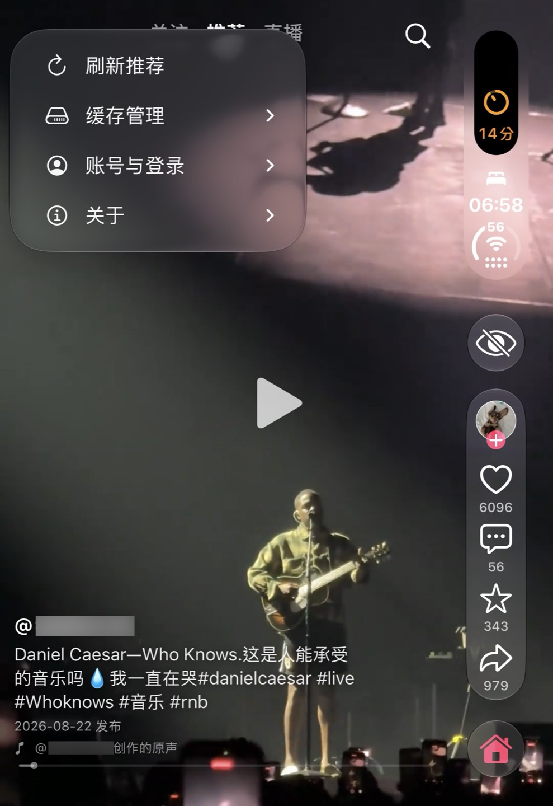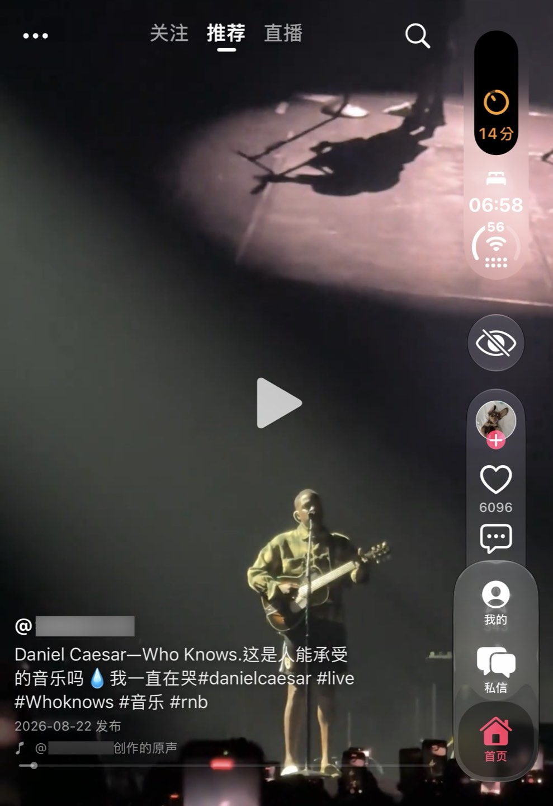</p>

### 评论：外屏与内屏

外屏使用贴边玻璃面板；内屏沿用普通材质侧栏。相关搜索置于评论标题下方，内屏打开评论时隐藏 Dock 与视频互动栏。支持下拉及右滑关闭；半折自动评论为常驻布局。

<p>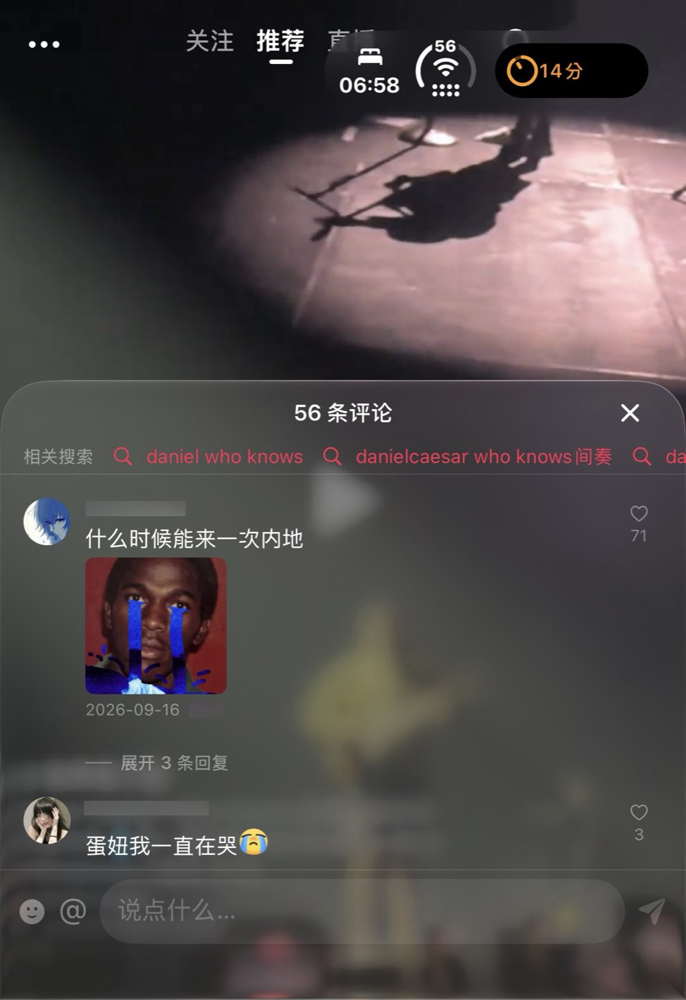</p>
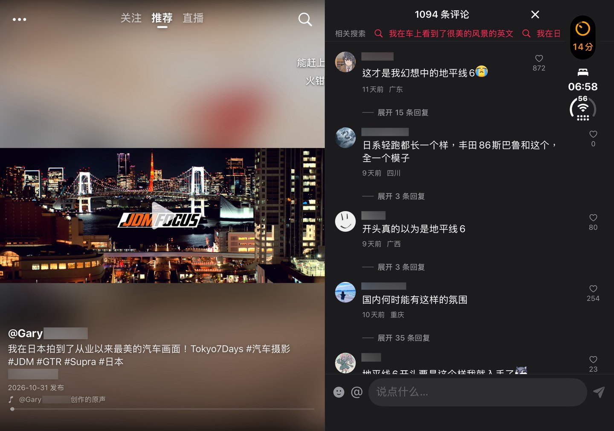

### 作者页：外屏与内屏

外屏显示作者作品页；内屏右侧显示作者资料与作品，左侧视频继续播放。返回、关注由系统工具栏安排；进入作者作品后停止底层视频，避免双路播放。

<p>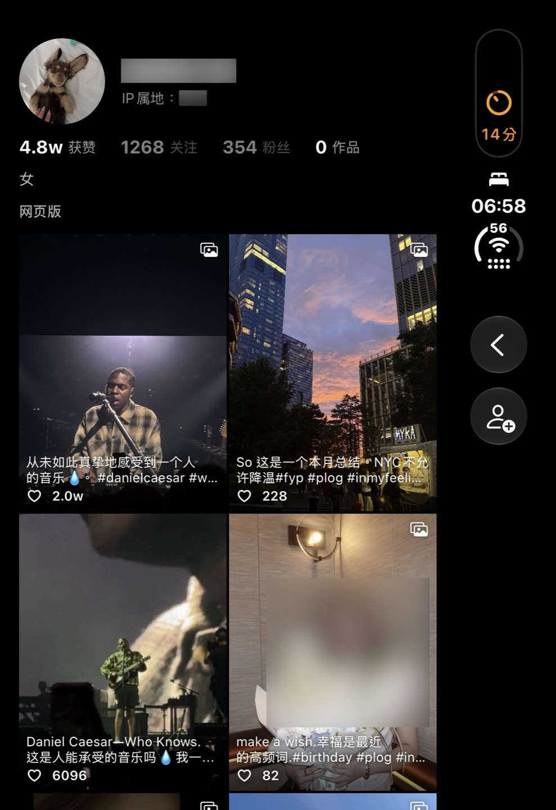</p>
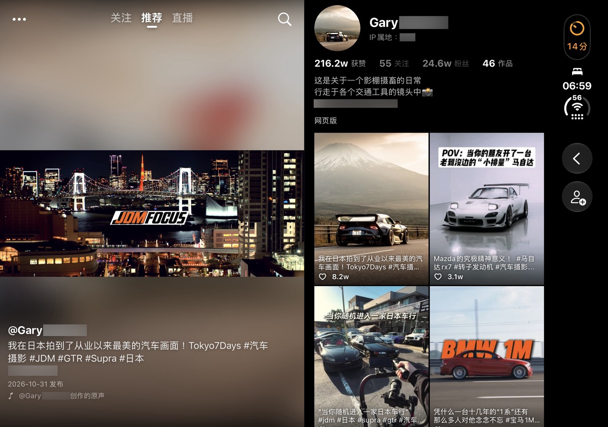

### 分享：外屏与内屏

保留原有联系人与分享能力，整理为两排；第二排为私信、群分享、复制链接、下载及其他分享。内屏面板位于右下角，占屏幕宽度一半、底部贴边，打开时保持视频原播放状态。

<p>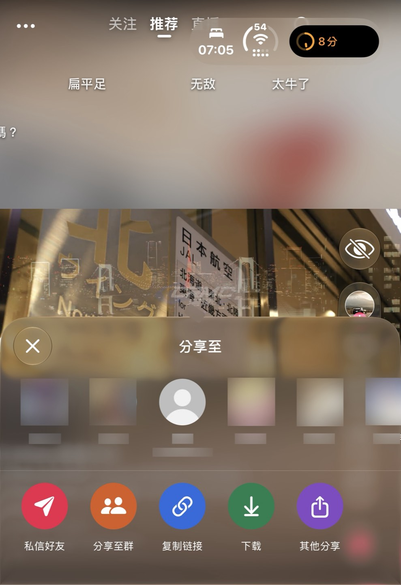</p>
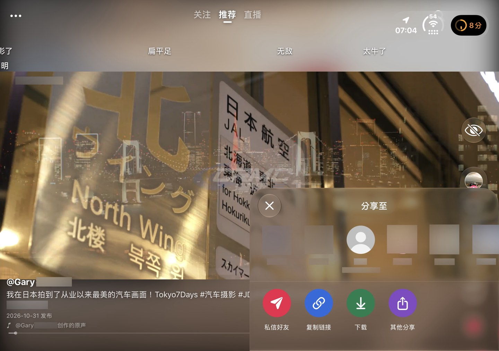

### 长按视频设置

屏幕中间约 40% 长按打开菜单，左右各约 30% 长按倍速。播放、内容偏好及弹幕设置默认展开，选中项加深背景；菜单支持下拉关闭，打开期间不暂停视频。

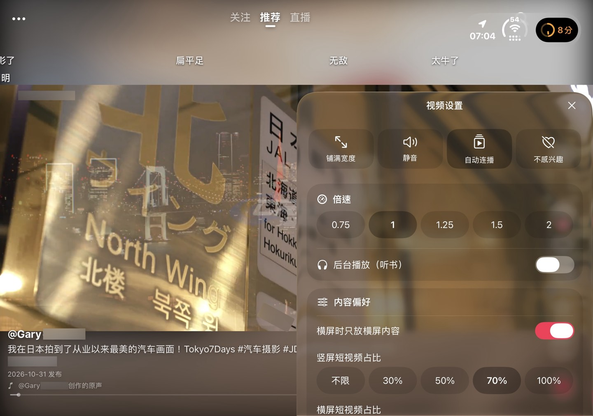

### 清屏模式

隐藏应用的顶栏、Dock、互动栏、简介、进度条与弹幕，仅保留视频及退出清屏按钮；系统状态栏与实时活动仍由系统管理。画中画适用于支持该功能的 AVPlayer 视频。


感谢社区各位对项目的开发与维护。

## 原项目说明与安装

<details>
<summary>展开原项目功能、安装与许可说明（上游截图仅作参考）</summary>

<p align="center">
  
</p>

<h1 align="center">douduo</h1>

界面和播放全部原生（SwiftUI + AVPlayer，VLC 兜底）。


官方抖音 App 在折叠屏内屏、iPad 上不适配，网页版又总是跳 App，所以有了它。

## 界面展示

以下为实际使用截图，保留原始画面，未打码；支持外屏、内屏与横竖屏布局。

### 竖屏播放：外屏 / 内屏

<p align="center">
  
  
</p>

### 内屏横屏播放与侧边评论


### 外屏横屏播放


### 直播：内屏横屏 / 外屏竖屏


<p align="center">
  
</p>

[查看截图说明与原图](docs/screenshots/README.md)。

> ⚠️ 非官方项目，仅供个人学习交流，与抖音 / 北京微播视界科技有限公司无关。详见文末[免责声明](#免责声明)。

## 功能

**看视频**
- 推荐 / 关注 / 直播，顶部一排切换；整页上下滑
- **秒开**：打开 App 先播上次已缓存的视频，连接抖音在后台进行
- **预缓存**：边看边在后台把后面 50 条完整下载到本地，下滑不等加载（菜单可选 关 / 20 / 50 / 100 条，总量超 2GB 自动清理）
- 屏幕任意位置**横滑快进 / 快退**（带预览缩略图），双击点赞，长按 2 倍速，单击暂停
- **自动铺满**：竖屏看竖屏铺满宽度、横屏看横屏铺满高度；方向不一致时保持完整画面（菜单可关）
- 退到后台立即停声

**互动**（需在 App 内登录抖音，见下文）
- 点赞、收藏，同步到你的抖音账号
- 评论：查看、展开楼中楼、**发评论 / 回复**
- **视频弹幕**：显示 + 发送（菜单可关）
- 直播：原生播放（VLC 解 HEVC 流）、**直播间聊天显示 + 发言**
- 保存视频 / 图集到相册

**我的**
- 搜索（联想词、搜索历史）
- 喜欢 / 收藏 / 观看历史 / 稍后再看，点进去接着上下滑
- 作者资料卡

## 下载与签名安装（国内用户）

- **Gitee 国内下载**：[发行版与 IPA 附件](https://gitee.com/remon8/douduo/releases)
- **GitHub 下载**：[最新发行版](https://github.com/81199000/DouDuo/releases/latest)
- GitHub 为主仓库，Gitee 为国内源码与安装包镜像。
- 下载文件名带 `unsigned.ipa` 的安装包；它是**未签名 IPA，不能下载后直接安装**，需要按下方教程自己签名。
- v1.3.14 修复 1.3.13 滑动卡顿：1x 播放改回系统原生声音（倍速时才启用独立音频引擎），简洁/极简进度环不再带动整屏重算；推荐页半折叠按真实折痕切分视频与评论，详见[更新说明](docs/releases/v1.3.14.md)。
- v1.3.13 新增三档界面模式（默认 / 简洁 / 极简，更多 → 界面）和折叠屏直播分屏与环境光，合入社区 PR #5、#11、#12；倍速改为点开选速度并修复改了不立刻生效；直播评论区与起播提速，详见[更新说明](docs/releases/v1.3.13.md)。
- v1.3.12 关注页与直播页去掉重复的直播头像入口，关注开播统一走「我的关注」；爱思助手签名失败可先在手机上用同一 Apple ID 登录一次 icloud.com 再签，详见[更新说明](docs/releases/v1.3.12.md)。
- v1.3.11 消息中心主从导航、聊天分享视频跳原生播放、评论通知回复与配图、聊天黑色画布与窄屏遮挡修复；右侧图标间距加大并调整展开位置；合入直播恢复与播放门禁（分享浮层暂停、切台恢复），详见[更新说明与待验收项](docs/releases/v1.3.11.md)。
- v1.3.10 倍速控制重做：设置里选播放速度（当前视频立刻生效）、长按下滑锁本条 2 倍速、长按上滑取消、非常速常驻角标；新增后台播放与锁屏控制、直播间选择列表、直播画质选档，详见[更新说明](docs/releases/v1.3.10.md)。
- v1.3.9 把「关注的人正在直播」头像排移到直播页顶部：进入展开、上滑换直播间收成「N 个直播」胶囊，关注页回归纯关注流，详见[更新说明](docs/releases/v1.3.9.md)。
- v1.3.8 新增原生「分享给」浮层（真实好友、官方作品卡片、发送即时回执），朋友与会话改为本地缓存 + 增量同步，弹幕限制在画面上方三分之一，直播分类接入真实分区，右侧栏顺序与间距对齐原版，详见[更新说明](docs/releases/v1.3.8.md)。
- v1.3.7 新增消息中心、陌生人消息分类、评论表情与 @ 用户、评论配图/贴纸及直播发现入口，详见[更新说明](docs/releases/v1.3.7.md)。

## 安装

本分支最低支持 **iOS 26.0**；经典布局需要 **iOS 27.1+**，26.x 使用上游布局。仅针对 iPhone Duo 适配，未测试 iPad。DouDuo 未在 App Store 上架，需要**自己签名安装**。以下方式任选一种：

先到 [Gitee 发行版](https://gitee.com/remon8/douduo/releases) 或 [GitHub Releases](https://github.com/81199000/DouDuo/releases/latest) 下载最新的 `DouDuo-x.y.z-unsigned.ipa`，不要下载源码 ZIP 代替 IPA。

### 方式一：爱思助手（Windows / Mac，最简单）

以下配图来自[爱思助手官方 IPA 签名教程](https://www.i4.cn/news_detail_38195.html)；**图中的应用文件名仅为官方示例，实际请选择我们下载的 `DouDuo-1.3.14-unsigned.ipa`**。

#### 1. 连接手机，打开 IPA 签名工具

电脑安装 [爱思助手](https://www.i4.cn)，用数据线连接 iPhone / iPad；解锁设备并点「信任此电脑」，确认电脑能识别设备，再进入 **工具箱 → IPA 签名**。


#### 2. 添加 DouDuo 安装包

点击「添加 IPA 文件」，选择发行版附件中的 `DouDuo-x.y.z-unsigned.ipa`，不要选择源码 ZIP。


#### 3. 使用 Apple ID 签名，选择要安装的设备

选择 **使用 Apple ID 签名 → 添加 Apple ID**，在爱思助手内输入 Apple ID 和密码（建议使用专门的小号），并选择当前连接手机的设备标识。签名与所选设备绑定，不要选成其他手机；如要求验证码，请在签名工具中完成验证。

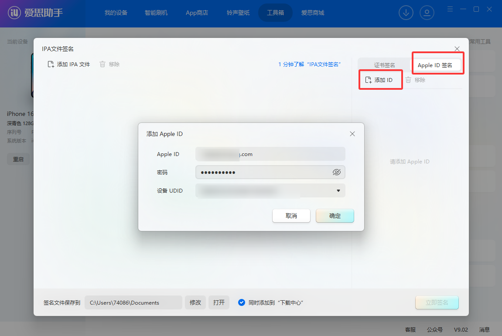

> **签名失败时：先用同一个 Apple ID 登录一次 iCloud。** 在手机 Safari 打开 [icloud.com](https://www.icloud.com)，用**准备签名的那一个 Apple ID** 登录一次（按提示同意条款、完成双重认证），退出页面后回爱思助手重新点「开始签名」。很多人卡在「签名失败 / 验证失败 / 无法请求签名」，都是因为该 Apple ID 没在设备上登录过 iCloud，登录一次再签通常就能过。

#### 4. 勾选安装包和 Apple ID，开始签名

勾选 DouDuo IPA 与对应 Apple ID，点击「开始签名」，等待状态显示「签名成功」。


#### 5. 打开签名目录，手动安装已签名 IPA

**签名完成不等于已经安装。** 点击「签名文件保存到」旁边的「打开」，找到新生成的已签名 IPA；它与刚下载的未签名原包可能不在同一个目录。

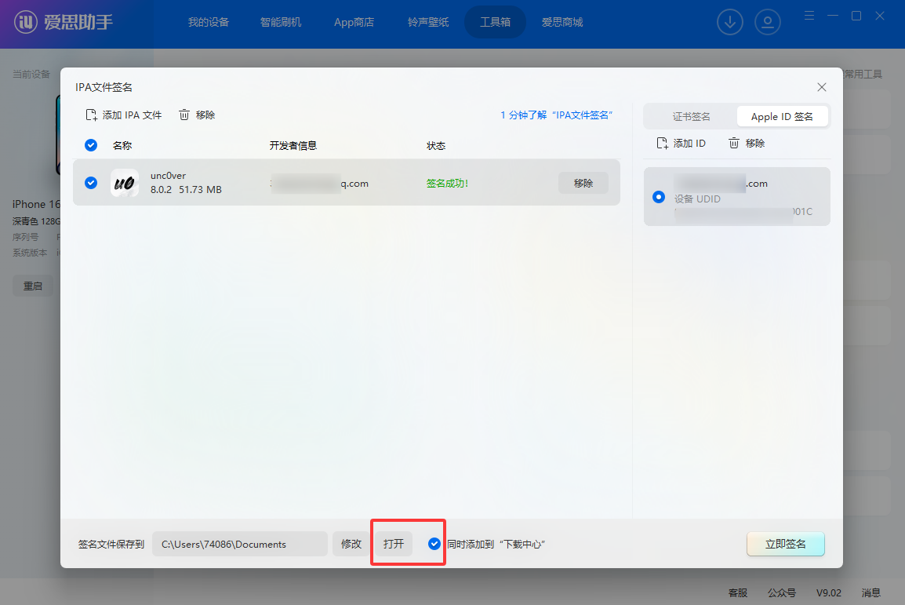

在打开的目录中找到已签名 IPA，双击交给爱思助手安装，或从爱思助手的应用管理中导入安装；**不要拿未签名原包直接安装**。

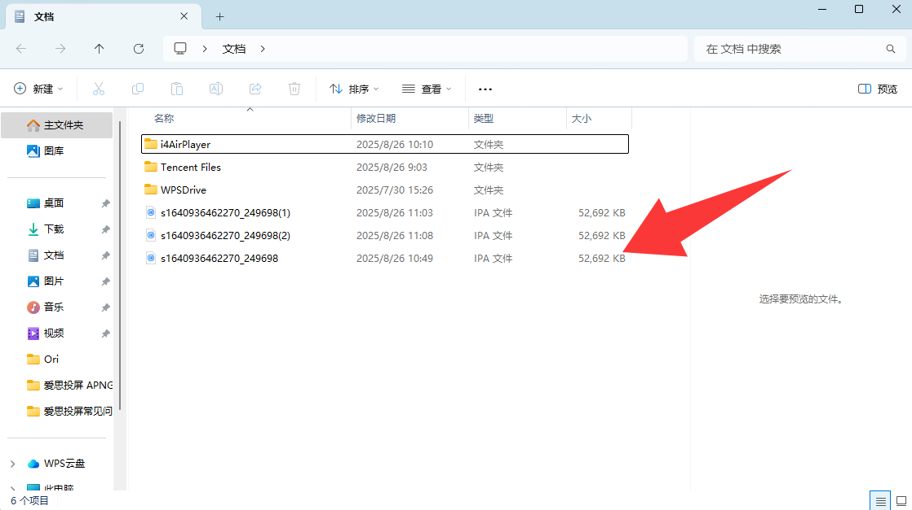

#### 6. 在手机上信任开发者并打开应用

手机打开 **设置 → 通用 → VPN 与设备管理**，找到签名使用的 Apple ID / 开发者条目，点「信任」。如系统要求，再打开 **设置 → 隐私与安全性 → 开发者模式**，按提示重启并确认启用，随后打开 DouDuo。

> **7 天到期怎么办？** 免费 Apple ID 签名通常 **7 天后过期**，届时可能打不开；重复以上签名流程并覆盖安装。尽量使用同一 Apple ID、保持相同应用标识，**不要先卸载旧 App**，以免丢失本地数据。
>
> **常见问题**：安装失败先检查设备是否选对、手机是否解锁并信任电脑，以及是否使用签名后的 IPA；不受信任或开发者模式提示按第 6 步处理。不同版本爱思助手的按钮名称和位置可能略有不同。

### 方式二：Sideloadly（Windows / Mac）

1. 安装 [Sideloadly](https://sideloadly.io)（Windows 还需要 iTunes 和 iCloud 的**官网桌面版**，不是微软商店版）
2. 连接 iPhone，把 IPA 拖进 Sideloadly 窗口
3. 「Apple account」填你的 Apple ID，点「Start」，按提示输入密码 / 双重认证验证码
4. 安装后同方式一的第 6 步：信任开发者、按系统提示打开开发者模式。

> 同样 7 天过期。Sideloadly 支持开启「Automatic refresh」，电脑开着、手机在同一 Wi‑Fi 时会自动续签。

### 方式三：手机上直接签（SideStore / AltStore / 第三方签名 App）

- **[SideStore](https://sidestore.io)**：首次需要电脑配置一次，之后在手机上就能安装、自动续签，不用再连电脑。装好后在 SideStore 里点「+」选择 IPA 即可
- **[AltStore](https://altstore.io)**：需要电脑上常驻 AltServer，同一 Wi‑Fi 下自动续签
- **自有证书的签名 App**（如 ESign、轻松签、全能签等）：如果你**自己有** p12 证书 + 描述文件（个人 / 企业开发者账号导出），导入证书后选择 IPA 签名安装
- **TrollStore（巨魔）**：签一次永久有效，但只支持部分系统版本（以 TrollStore 官方说明为准），较新的 iOS 用不了

> ⚠️ 不要使用网上流传的「免费证书」「共享企业证书」：这类证书随时会被苹果吊销（掉签打不开），也存在隐私风险。

### 方式四：自己编译（有 Mac）

需要 macOS + Xcode 26 以上、[XcodeGen](https://github.com/yonaskolb/XcodeGen)。

```bash
git clone https://github.com/81199000/DouDuo.git
cd DouDuo
brew install xcodegen
./scripts/fetch-vlckit.sh      # 下载 VLC 播放内核（约 1GB，不在仓库里）
xcodegen generate
open DouDuo.xcodeproj
```

在 Xcode 里：
1. 选中 `DouDuo` target →「Signing & Capabilities」→ Team 选你自己的 Apple ID（Xcode → Settings → Accounts 先登录）
2. 把 Bundle Identifier 改成你自己的（比如 `com.yourname.douduo`），免费账号不能用别人注册过的 ID
3. 连上 iPhone，选中设备，点 ▶︎ 运行
4. 手机上信任开发者 + 按系统提示打开开发者模式（同方式一的第 6 步）

免费账号同样 7 天有效；付费开发者账号（99 美元 / 年）签的一年有效。

只想要未签名 IPA：`./release.sh`（产物在 `build/`，有 `gh` 登录时会顺带上传 Release）。

## 首次使用：登录抖音

点右上角「我的」→「网页版 / 登录」，在抖音网页里用**验证码或密码**登录。登录后：

- 推荐流会按你的账号个性化
- 点赞、收藏、评论、弹幕会同步到你的抖音账号
- 「我的」里能看到喜欢、收藏、观看历史

不登录也能看推荐、搜索、直播。登录信息只保存在手机本地，不经过任何第三方服务器。

## 常见问题

- **打开就闪退**：签名过期了（免费 Apple ID 7 天），重新签名安装即可。
- **提示「抖音拦截了请求」/ 一直加载**：点菜单 →「网页版 / 登录」，在网页里刷一下（必要时过一下滑块验证），返回后会自动重试。
- **视频黑屏或卡住**：App 会自动重试，并切换到 VLC 内核兜底；仍不行就下滑到下一条。
- **占用空间大**：菜单 →「预缓存视频」调小或关闭，或者点「清除视频缓存」。用流量刷时建议关掉预缓存。
- **搜索结果只有一页**：抖音网页接口只返回第一页，目前没有办法翻页。

## 原理

没有逆向抖音 App，也不需要任何密钥：

- App 里挂着一个**看不见的抖音网页**（电脑版 UA）。所有接口请求都在这个页面里发出，由抖音网页自己的安全 SDK 自动补签名（`a_bogus` 等），所以签名算法跟着官方更新走。
- 视频地址用接口返回的 `/aweme/v1/play/`（302 到 CDN mp4）。CDN 要求带浏览器 UA + Referer，否则部分节点 403。
- 普通视频用 `AVPlayer`；起不来时自动切 VLC。直播流是 HEVC + MPEG‑TS，AVPlayer 只能出声音，所以直播一律用 VLC。
- 直播间聊天：后台打开一个隐藏的直播间网页，读它渲染出来的聊天列表，不碰 WebSocket 协议。
- 登录态和「网页版」共用 `WKWebsiteDataStore.default()`，只存在本机。

主要接口：

| 功能 | 接口 |
| --- | --- |
| 推荐 | `POST /aweme/v2/web/module/feed/` |
| 关注 | `/aweme/v1/web/follow/feed/` |
| 搜索 / 联想 | `/aweme/v1/web/search/item/`、`/search/sug/` |
| 评论 / 楼中楼 / 发评论 | `/comment/list/`、`/aweme/v2/web/comment/list/reply/`、`POST /comment/publish` |
| 弹幕 / 发弹幕 | `/danmaku/get_v2/`、`POST /danmaku/post_v2/` |
| 点赞 / 收藏 | `POST /commit/item/digg/`、`POST /commit/item/collect/` |
| 喜欢 / 收藏 / 历史 / 稍后再看 | `/aweme/favorite/`、`POST /aweme/listcollection/`、`/history/read/`、`/watchlater/list/` |
| 直播 | `live.douyin.com/webcast/feed/` |

## 项目结构

```
DouDuo/
  DouDuoApp.swift          入口、退后台停声
  DouyinFeedView.swift     推荐 / 直播主界面、签名代理（DouyinBridge）、评论
  DouyinExtras.swift       搜索、我的、关注、作者页、弹幕、保存、发评论 / 弹幕
  DouyinLiveChat.swift     直播间聊天（显示 + 发言）
  DouyinVideoCache.swift   本地视频预缓存 + 秒开
  ShortVideoPlayer.swift   播放器（手势、进度、VLC 兜底、弹幕层）
  VLCPlayerBridge.swift    VLC 封装
  DouyinWebView.swift      网页版容器（登录）
Vendor/VLCKit/             VLC 本地 Swift Package（二进制用脚本下载）
project.yml                XcodeGen 工程定义
```

## 已知限制

- 搜索只有第一页；作者的作品列表要点「查看全部作品」去网页版看（网页接口签名受限）
- 抖音风控时可能要去「网页版」过一下验证
- 抖音网页接口改版时，需要跟着更新

欢迎提 Issue / PR。

## 免责声明

> 本声明说明项目意图与边界，**不构成法律意见，也不能免除法律责任**；它不能替代权利人的授权。

- **非官方、无授权**：本项目是个人学习与技术研究用的第三方客户端，与抖音、北京微播视界科技有限公司及其关联公司**没有任何隶属、合作或授权关系**。「抖音」等名称、商标、图标归其权利人所有，本项目仅作描述性提及，不把官方标识当作自己的品牌，也不代表官方立场。
- **不提供、不存储、不分发内容**：App 只在你自己的设备上展示通过抖音网页接口获取的内容，不搭建内容服务、不缓存分发、不提供下载。视频、图片、音乐、评论、直播流的版权归原作者与平台所有。
- **账号与使用责任**：使用本项目需要你自己的抖音账号登录。请自行遵守《抖音用户服务协议》和所在地法律；**禁止**用于商业用途、批量抓取、刷量、绕过付费或权限、二次分发，以及其他侵害他人权益的行为。账号被限制、数据丢失、设备异常等后果由使用者自行承担。
- **不绕过付费与权限**：本项目不提供会员内容、付费内容、私密内容的解锁能力，也不修改平台返回的权限结果。
- **签名与分发**：仓库只提供**未签名 IPA**，签名须由使用者用自己的 Apple ID 完成（免费账号通常 7 天有效）。请勿使用他人证书，也请勿分发已签名安装包。
- **无担保**：软件按「现状」提供，不保证可用性、稳定性、合规性或适用于特定目的；平台接口改版或风控可能导致功能随时失效。
- **侵权处理**：如权利人认为本项目侵犯其权益，请通过 Issue 或仓库公开的联系方式告知，核实后会删除相关内容或停止分发。
- **地区差异**：不同国家和地区对第三方客户端、逆向与接口调用的规定不同；如当地法律禁止，请不要使用或分发本项目。

## License

[MIT](LICENSE)

</details>
