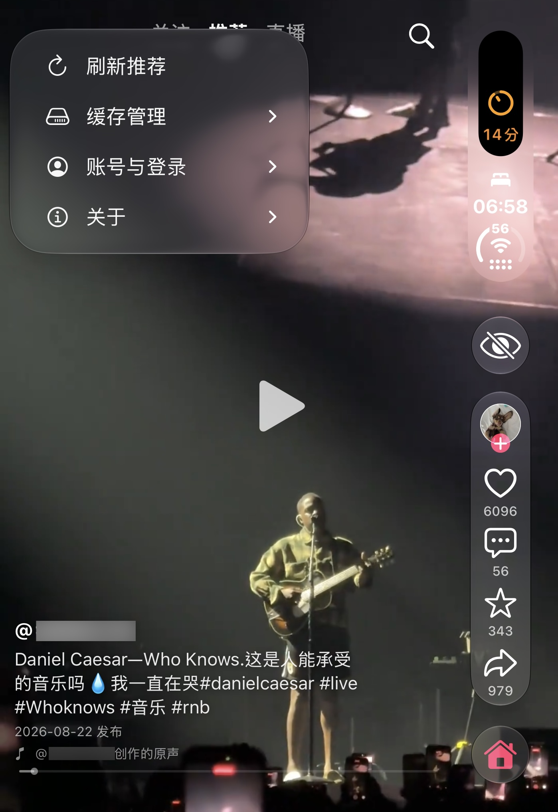
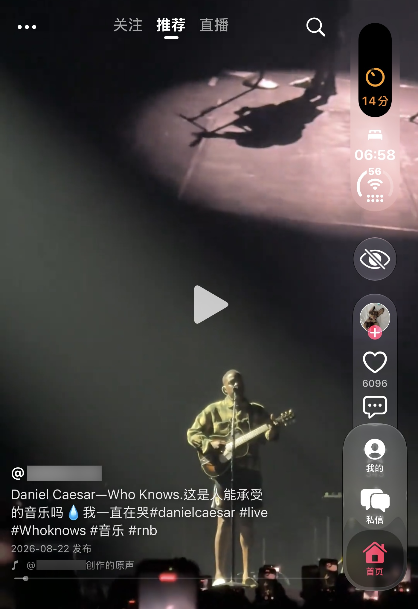
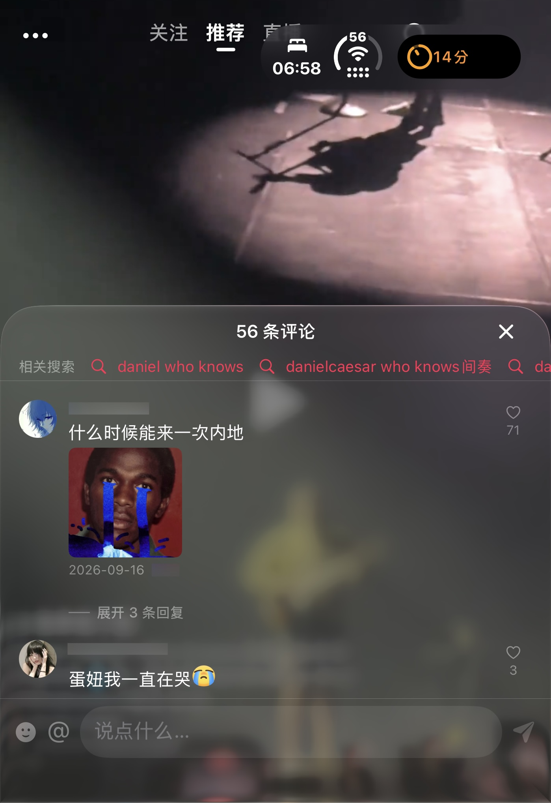
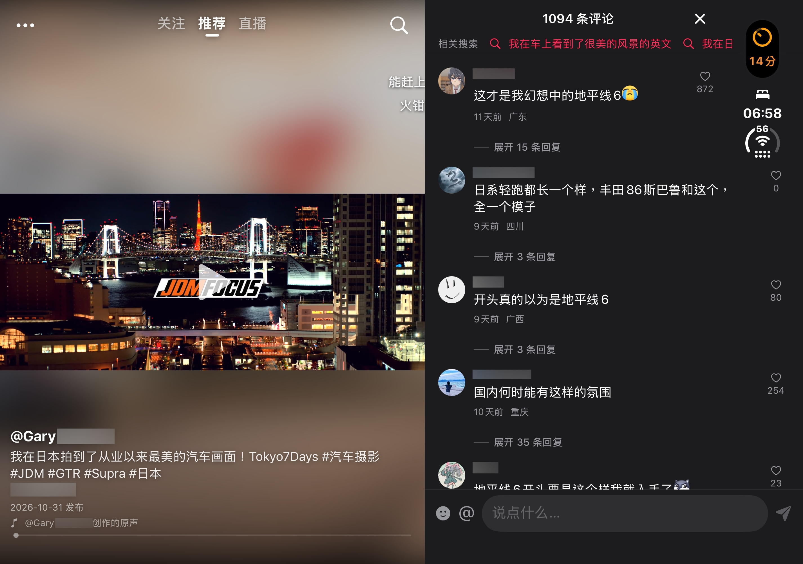
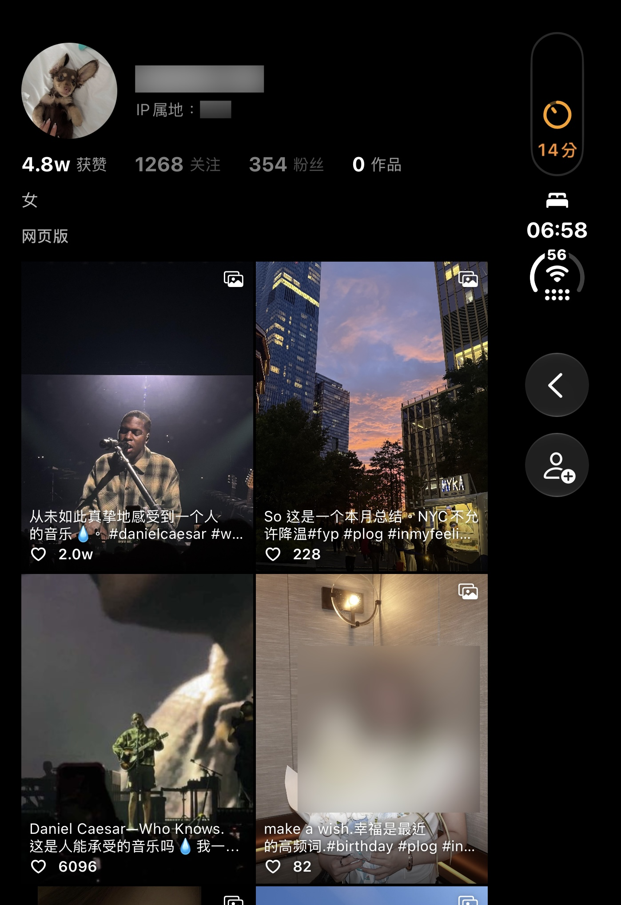
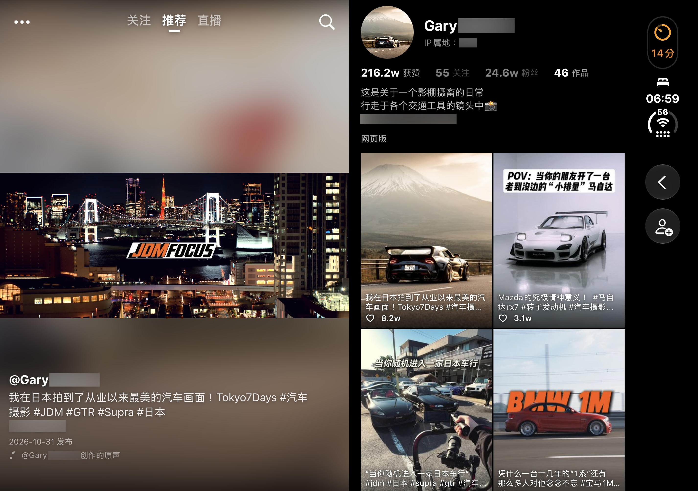
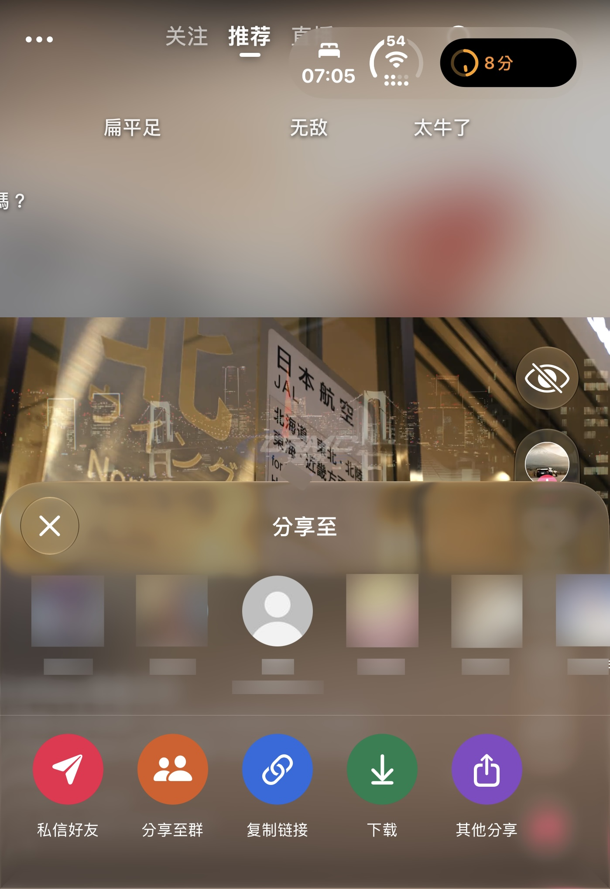
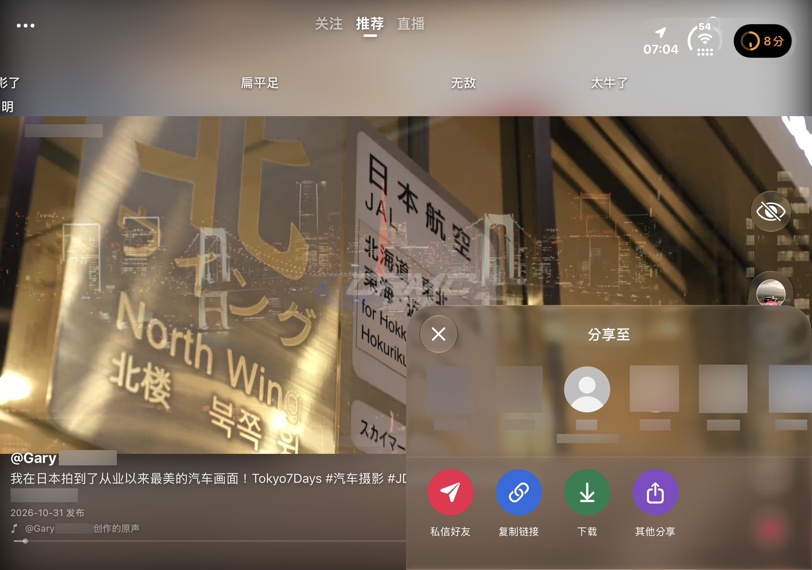
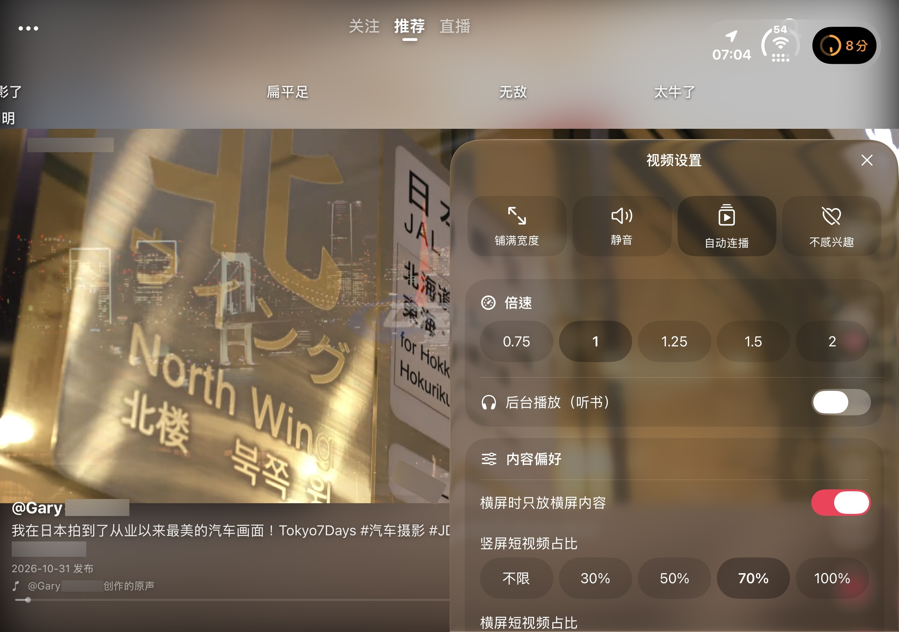
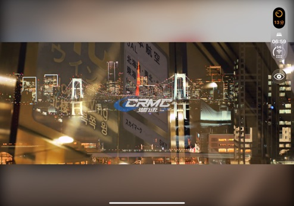

# DouDuo：更接近抖音的 iPhone Duo 布局与手势优化

原项目：[81199000/DouDuo](https://github.com/81199000/DouDuo)。基于 **DouDuo v1.3.12（64a8ef7）**，**尚未并入 v1.3.13**。

**本次仅针对 iPhone Duo 的内屏、外屏和折叠布局适配，未测试 iPad，不声称已完成 iPad 适配。** 当前实现使用 iOS 27.1+ 的系统工具栏能力。

并入建议：将这套布局与手势作为可选的“经典布局”，保留项目的其他布局。此项是合入建议，当前分支尚未提供新旧布局切换开关，也未完成旧版 iOS 的兼容处理。

## 一、Dock 与互动栏

- 使用系统 `TabView` 分隔“我的／私信／首页”，竖向顺序固定为我的、私信、首页；移除我的、私信根页面的返回按钮，保留二级页面返回。
- 首页通过系统工具栏空间分配和压缩优先级，使 Dock 默认收起；点击当前栏目可展开系统选择器。仅 Dock 选中项采用与开关一致的主题红色，其他按钮颜色不受影响。收缩仍由系统布局决定，并非私有 API 强制隐藏。
- 互动栏统一包含头像、点赞、评论、收藏、分享；使用紧凑的液态玻璃胶囊，分享采用空心图标，去除图标后方阴影。
- 头像下方增加小型关注加号，点击即可关注；已关注作者不显示加号，头像和作者页的关注状态同步。
- 非首页作品播放器复用同一组互动操作，返回按钮与互动胶囊分离，互动栏放在系统侧栏下方，避免实时活动挤压后收进“更多”。不再提供下方的更多入口。
- 进入直播间隐藏应用的 Dock、侧栏操作和顶部频道栏，退出直播间恢复；系统时间和实时活动由系统管理。

## 二、视频播放与清屏

- 清屏按钮使用 `eye.slash` / `eye`；开启后隐藏应用的顶栏、Dock、互动栏、简介、进度条与弹幕，只保留视频和退出清屏按钮。系统状态信息仍由系统管理。
- 清屏状态退出 App 时，支持系统画中画的 AVPlayer 视频可继续小窗播放；普通视频仍遵循既有后台播放开关。VLC 回退播放器暂不支持画中画。
- 双指捏合切换原比例与铺满宽度偏好，松手后视频回正；并非任意倍率缩放。视频未覆盖的区域用模糊封面填充，各视频入口保持一致。
- 打开分享面板和长按菜单不主动暂停或恢复视频，保留用户原本的播放／暂停状态。
- 内屏并排打开作者页时，左侧视频继续播放；进入作者作品的全屏播放器时停止底层视频，退出作品后恢复原页面。

## 三、视频布局与手势

### 1. 视频简介与进度条

调整作者名、简介、发布时间／声明、音乐与进度条的位置、字号、字重和颜色，区分信息权重。简介默认最多三行，超出后提供展开／收起；底部内容避开系统退出条。

### 2. 固定顶栏

左侧更多按钮直接显示刷新推荐、缓存管理、账号与登录、关于等全局设置；中间为关注、推荐、直播，右侧为搜索。顶栏不随视频分页消失，并修正内屏旋转后的安全区高度。

### 3. 分享与评论面板

- 在原有原生分享功能上重做布局与材质：第一排联系人，第二排私信、群分享、复制链接、下载、其他分享等操作，按钮增加颜色；具体项随联系人及登录状态显示。
- 外屏评论和分享面板贴齐左右及下边缘；内屏分享位于右下角，宽度为全屏一半，第二排高度与外屏保持一致。面板外部不再叠加暗色蒙版。
- 评论标题替代顶部拖动横条，相关搜索放在标题下方；修正输入区遮罩、裁剪和底部安全距离。
- 评论支持标题区下拉、列表顶部下拉，以及评论列表右滑关闭。列表中段上下滚动不触发关闭，相关搜索横向滚动保留自身行为。
- 内屏评论保留原版宽度与普通纯色背景，打开时隐藏视频互动栏与 Dock；半折自动打开的常驻评论采用相同隐藏规则。
- 推荐、关注、我的、搜索及作者作品共用评论组件和呈现规则。

### 4. 长按菜单

将原更多菜单中的播放设置、内容偏好、弹幕设置、不感兴趣移入统一视频设置面板，选项默认展开；保留现有设置值与业务功能。使用一致的材质、选中加深背景和分段选择样式，移除首排按钮最后方的整块背景。

以实际窗口全宽计算：左右各约 30% 长按倍速，中间约 40% 长按打开菜单；系统状态列不再缩窄分区基准。菜单支持标题区下拉及列表顶部下拉关闭，与评论共用手势规则。

### 5. 作者页与导航手势

推荐页左滑、点击头像或作者名进入作者页；内屏作者页在右侧并排显示。关注、返回按钮交由系统工具栏安排，并隐藏 Dock。关注页左滑返回推荐。

### 6. 手势协调与反馈

- 修复上下拖动视频后不松手时误触长按倍速。
- 视频区域横向滑动用于页面导航，保留进度条自身拖动定位，移除整屏横滑拖进度。
- 点赞、长按倍速增加震动反馈；双指操作与单指导航、倍速手势互斥。

## 布局与功能截图

以下截图展示本次相对原版的布局与功能变化，已对部分显示内容模糊处理。

### 首页与系统 Dock

固定顶栏、头像关注加号及紧凑互动胶囊；仅 Dock 选中项为红色。第二张展示点击后的系统展开状态，此时 Dock 会临时覆盖部分互动区域。

### 评论：外屏与内屏

外屏使用贴边玻璃面板；内屏沿用普通材质侧栏。相关搜索置于评论标题下方，内屏打开评论时隐藏 Dock 与视频互动栏。支持下拉及右滑关闭；半折自动评论为常驻布局。

### 作者页：外屏与内屏

外屏显示作者作品页；内屏右侧显示作者资料与作品，左侧视频继续播放。返回、关注由系统工具栏安排；进入作者作品后停止底层视频，避免双路播放。

### 分享：外屏与内屏

保留原有联系人与分享能力，整理为两排；第二排为私信、群分享、复制链接、下载及其他分享。内屏面板位于右下角，占屏幕宽度一半、底部贴边，打开时保持视频原播放状态。

### 长按视频设置

屏幕中间约 40% 长按打开菜单，左右各约 30% 长按倍速。播放、内容偏好及弹幕设置默认展开，选中项加深背景；菜单支持下拉关闭，打开期间不暂停视频。

### 清屏模式

隐藏应用的顶栏、Dock、互动栏、简介、进度条与弹幕，仅保留视频及退出清屏按钮；系统状态栏与实时活动仍由系统管理。画中画适用于支持该功能的 AVPlayer 视频。

感谢社区各位对项目的开发与维护。
