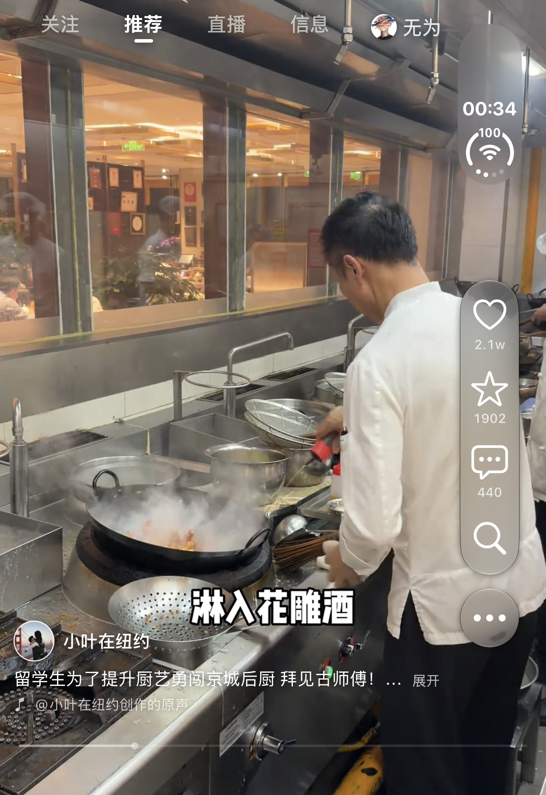
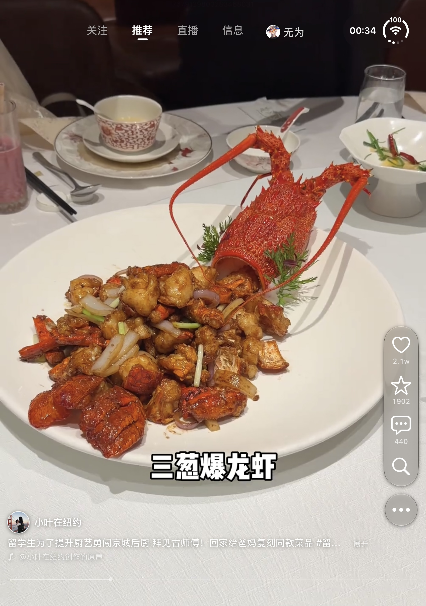
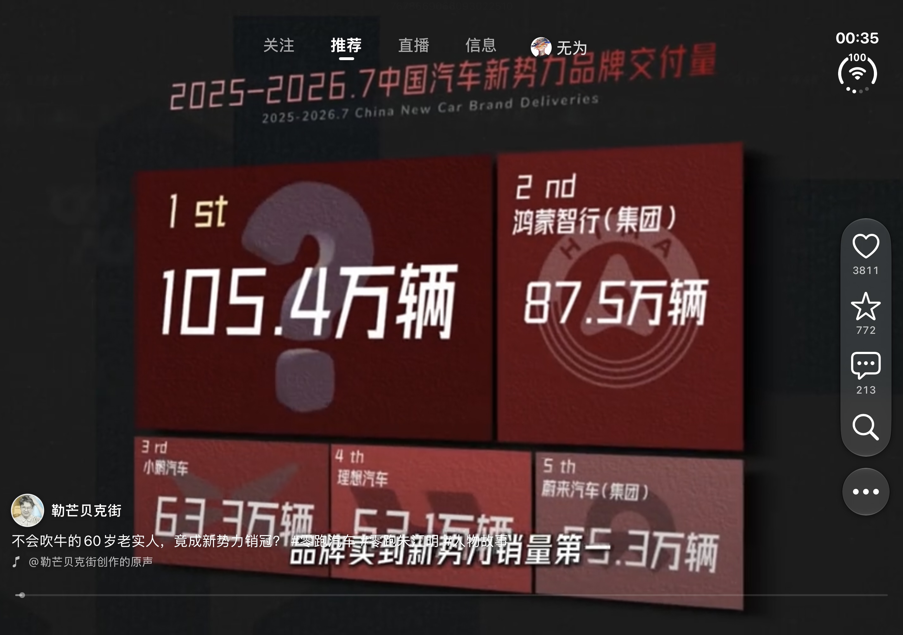
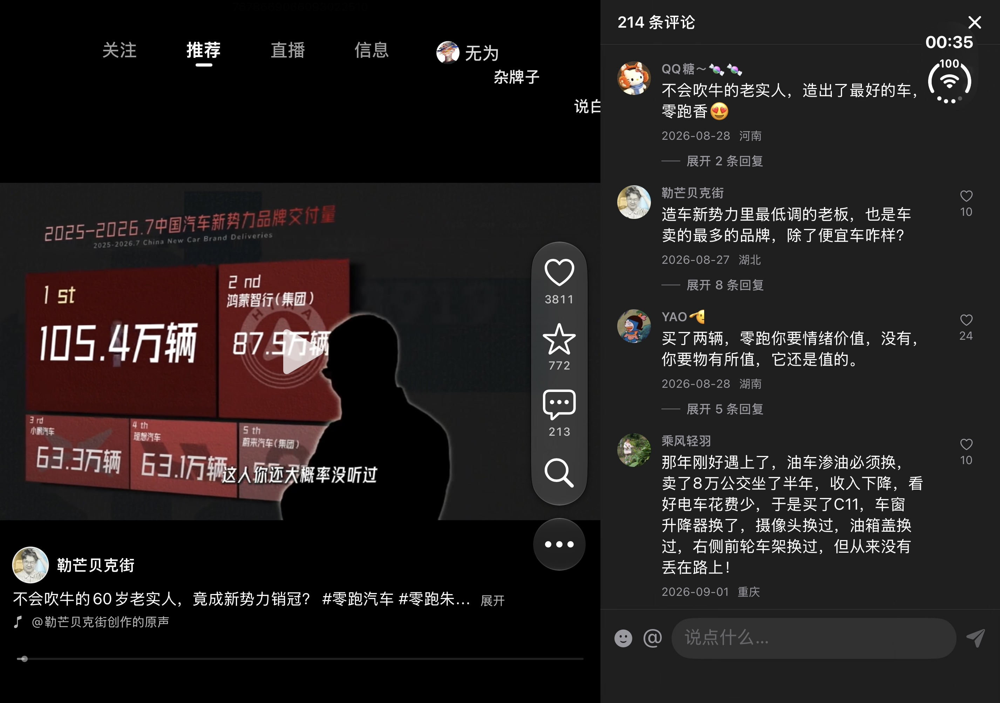
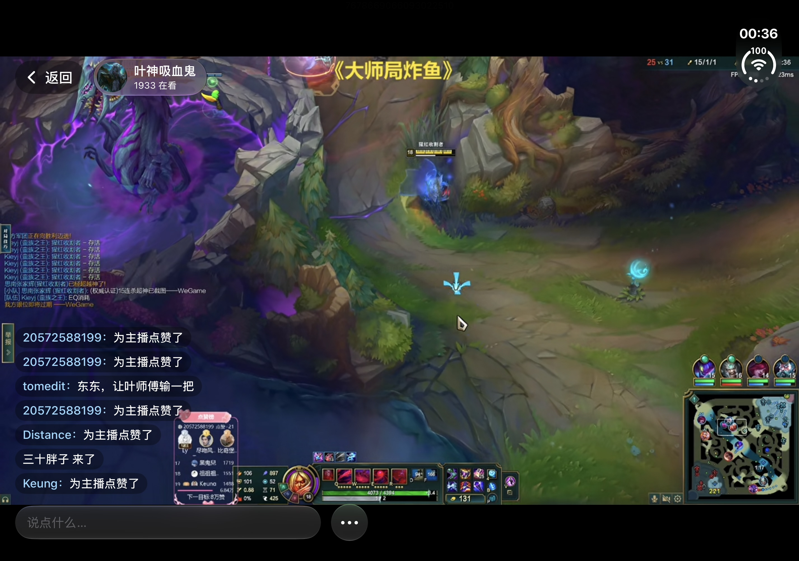
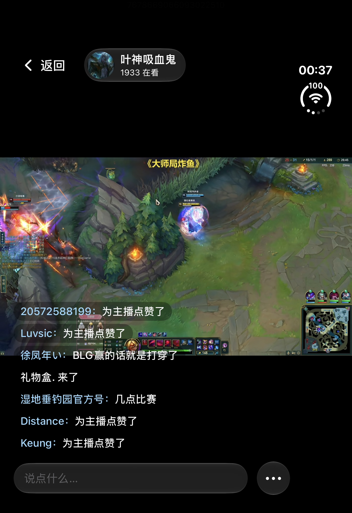

# DouDuo 界面截图

以下为用户提供的实际使用截图，**未打码、未裁剪**；只将 HEIC 转换为网页通用的 JPEG，保留原始分辨率。

## 外屏竖屏播放

## 内屏竖屏播放

## 内屏横屏播放

## 横屏侧边评论

## 外屏横屏播放

## 内屏横屏直播

## 外屏竖屏直播

## 来源

- 当前收到并收录 7 张图片；原始文件名、分辨率及校验值见 [manifest.json](manifest.json)。
- 图片由用户提供，不将它们标注为本次自动化采集的模拟器截图。
- 本次只更新展示图片与安装图文，不修改 App 功能或安装包。
